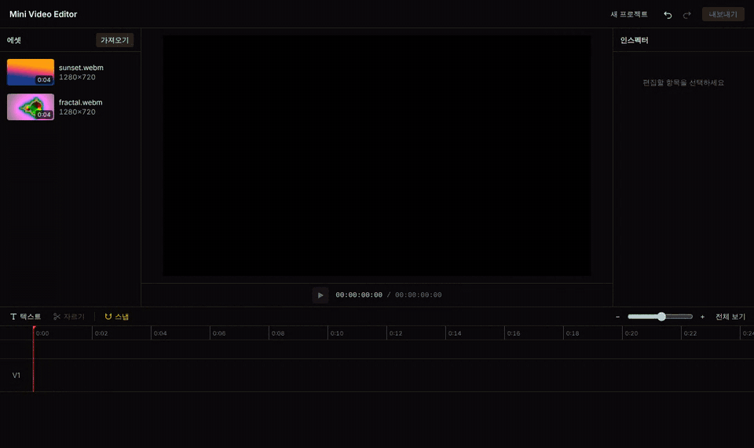
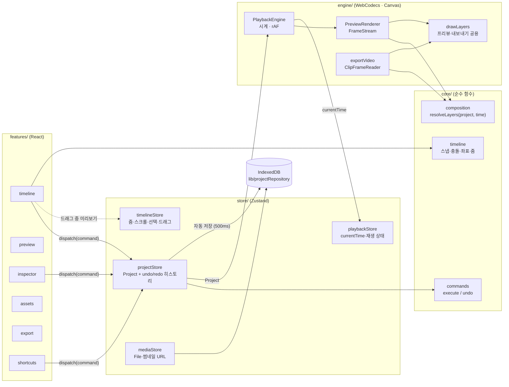

# Mini Video Editor

브라우저에서만 동작하는 미니 영상 편집기입니다. 서버 없이 영상 클립을 올려 자르고, 배치하고, 텍스트를 얹어
MP4로 내보냅니다. 디코딩·합성·인코딩이 모두 사용자의 브라우저에서 WebCodecs로 이루어집니다.



<sub>데모: 에셋을 타임라인에 끌어다 놓고, 텍스트를 추가해 스타일과 위치를 바꾸고, 재생한 뒤, 자르기를 되돌리고 MP4로 내보낸다 (내보내기 구간은 3배속).</sub>

## 주요 기능

- **가져오기**: 영상(MP4·MOV·WebM·MKV)과 이미지. 썸네일·길이·해상도를 읽어 에셋 패널에 표시
- **타임라인 편집**: 드래그로 배치·이동(트랙 간 포함), 양 끝 트리밍, 플레이헤드에서 자르기, 삭제, 트랙 추가·삭제
- **스냅**: 모든 트랙의 클립 경계·플레이헤드·0초에 화면 기준 8px로 스냅 (Alt로 일시 해제), 스냅되지 않으면 프레임 경계로 반올림
- **줌·스크롤**: 2~1000px/s, Ctrl/Cmd+휠·핀치는 포인터 아래 시각 고정, 드래그 중 가장자리 자동 스크롤
- **프리뷰**: Canvas 2D 합성, 클립 경계에서 끊기지 않는 재생, 프레임 단위 탐색
- **텍스트 오버레이**: 여러 줄, 글자 크기·색상·위치를 인스펙터에서 수정, 프리뷰에서 직접 드래그
- **SRT 자막**: `.srt`를 가져오면 텍스트 트랙에 자막으로 배치(겹치는 자막은 위 트랙·위 위치로), 텍스트처럼 편집한 뒤 SRT로 다시 저장
- **undo/redo**: 모든 편집이 커맨드로 실행되어 되돌릴 수 있음. 연속 입력은 한 항목으로 합침
- **키보드 단축키**: Space 재생, Delete/Backspace 삭제, S 자르기, Ctrl/Cmd+Z·Shift+Ctrl/Cmd+Z·Ctrl+Y (한글 자판에서도 동작)
- **자동 저장**: IndexedDB에 자동 저장, 새로고침하면 원본 파일까지 복원
- **MP4 내보내기**: 1920×1080 · 30fps, 진행률·남은 시간 표시, 취소 가능 (H.264 → VP9 → AV1 중 인코딩 가능한 코덱)
- **브라우저 호환성 안내**: WebCodecs 미지원 시 어떤 기능을 쓸 수 없는지 안내

## 실행 방법

Node.js 22 이상과 pnpm 10이 필요합니다.

```bash
pnpm install
pnpm dev          # http://localhost:5173
```

| 명령                | 설명                                      |
| ------------------- | ----------------------------------------- |
| `pnpm dev`          | 개발 서버                                 |
| `pnpm build`        | 타입 검사 후 프로덕션 빌드 (`dist/`)      |
| `pnpm preview`      | 프로덕션 빌드 미리보기                    |
| `pnpm test:run`     | 테스트 1회 실행 (Vitest, 45개 파일 398개) |
| `pnpm test`         | 테스트 watch 모드                         |
| `pnpm typecheck`    | TypeScript 타입 검사                      |
| `pnpm lint`         | ESLint                                    |
| `pnpm format:check` | Prettier 검사                             |

### 배포

`vercel.json`에 Vite 빌드 설정, 해시된 정적 파일(`/assets/*`) 장기 캐시, 보안 헤더가 들어 있습니다.
Vercel에서 이 저장소를 Import하면 별도 설정 없이 배포됩니다. GitHub Actions(`.github/workflows/ci.yml`)가 push·PR마다
타입 검사·린트·포맷·테스트·빌드를 실행합니다.

## 브라우저 지원

| 브라우저          | 편집·재생 | MP4 내보내기  |
| ----------------- | --------- | ------------- |
| Chrome / Edge 94+ | ✅        | ✅            |
| Safari 16.4+      | ✅        | ✅            |
| Firefox 130+      | ✅        | ✅ (데스크톱) |

실제 동작은 Chromium에서 검증했고, 나머지는 WebCodecs 지원 버전 기준입니다. WebCodecs(`VideoDecoder`, `VideoEncoder`)와 보안 컨텍스트(HTTPS 또는 localhost)가 필요합니다. 지원하지 않는 브라우저에서는
상단에 안내가 표시되고 해당 기능이 비활성화됩니다. 브라우저·OS에 따라 H.264 인코더가 없으면 VP9/AV1로 MP4를 만들며,
이 경우 일부 플레이어(QuickTime 등)에서 재생되지 않을 수 있다고 완료 창에서 알려줍니다.

## 아키텍처



| 폴더              | 역할                                                                             |
| ----------------- | -------------------------------------------------------------------------------- |
| `src/core/`       | React와 무관한 순수 로직: 시간 변환, 스냅, 충돌 검사, 커맨드, 합성, 저장본 검증  |
| `src/engine/`     | 디먹싱·디코딩(mediabunny + WebCodecs), 캔버스 렌더링, 재생 루프, 내보내기        |
| `src/store/`      | Zustand store (Project·히스토리, 타임라인 화면 상태, 재생 상태, 미디어)          |
| `src/features/`   | 기능별 React UI (타임라인·프리뷰·인스펙터·에셋·내보내기·자막·단축키·저장·호환성) |
| `src/components/` | 공용 UI. `ui/`는 shadcn/ui 컴포넌트 (Radix 기반, 소스 소유)                      |
| `src/lib/`        | IndexedDB 래퍼 (`ProjectRepository` 인터페이스 + idb 구현), 다운로드, `cn`       |
| `docs/devlog/`    | 개발 중 마주친 문제와 해결 기록                                                  |

### 데이터 흐름의 핵심

1. **Project가 단일 진실 공급원**입니다. 타임라인과 프리뷰는 모두 `Project`에서 파생됩니다.
2. **"무엇을 그릴지"와 "어떻게 그릴지"를 나눕니다.** `resolveLayers(project, time)`은 시각 t에 보여야 할 레이어(클립 프레임
   시각, 텍스트)를 계산하는 순수 함수이고, `PreviewRenderer`·`exportVideo`가 이를 디코딩해 같은 `drawLayers`로 그립니다.
   그래서 프리뷰와 내보낸 영상이 같은 결과를 냅니다.
3. **모든 편집은 커맨드**입니다. `Command { label; execute(project); undo(project) }`는 Project를 받아 새 Project를 돌려주는
   순수 함수라 React 없이 테스트하고, 모든 커맨드의 `execute → undo → redo` 왕복을 하나의 표로 검증합니다.

## 기술적 의사결정

| 결정                                                         | 이유                                                                                                                                                                                                |
| ------------------------------------------------------------ | --------------------------------------------------------------------------------------------------------------------------------------------------------------------------------------------------- |
| 시간은 **마이크로초 정수**                                   | WebCodecs timestamp와 같은 단위. 부동소수점 초는 `0.1 + 0.2` 같은 오차가 클립 경계 비교·스냅을 깨뜨린다. 화면에 표시할 때만 변환한다                                                                |
| `<video>` 대신 **Canvas + WebCodecs**                        | 여러 클립·이미지·텍스트를 한 화면에 합성하고, 프리뷰와 내보내기가 같은 그리기 코드를 쓰기 위해. `<video>`는 정확한 프레임 제어와 클립 간 끊김 없는 전환이 어렵다                                    |
| **mediabunny** (MPL-2.0)                                     | MP4·MOV·WebM·MKV 디먹싱, 디코더 관리, MP4 먹싱을 한 라이브러리로 해결. 용량이 커서 동적 import로 첫 화면 번들에서 분리했다                                                                          |
| 프리뷰는 **늦은 프레임을 건너뛰고**, 내보내기는 **기다린다** | 재생은 실시간이 중요하므로 준비된 프레임만 그리고 다음 클립을 1초 전부터 미리 디코딩한다(`FrameStream`). 내보내기는 정확성이 중요하므로 `ClipFrameReader`로 필요한 프레임을 기다린다                |
| **Zustand** + 커맨드 패턴                                    | 커맨드가 순수 함수라 Zustand의 불변 업데이트와 잘 맞는다. 재생 중 매 프레임 바뀌는 `currentTime`은 React 리렌더 없이 `subscribe`로 DOM을 직접 갱신한다                                              |
| 드래그 중에는 **Project를 바꾸지 않음**                      | 드래그 상태는 화면 상태 store에만 두고 놓을 때 커맨드를 한 번 실행한다. undo 한 번에 드래그 전체가 되돌아가고, 드래그 중 프리뷰·자동 저장이 흔들리지 않는다                                         |
| 타임라인 **가상화**                                          | 보이는 영역 ± 화면 1개 폭에 걸치는 클립·눈금만 그린다. 클립 100개에서 rAF 간격 p95 16.7ms                                                                                                           |
| **IndexedDB + localStorage 백업**                            | 비동기 IndexedDB 저장은 페이지를 떠나는 중에 끝나지 못할 수 있어, 저장되지 않은 변경은 `pagehide`에서 localStorage에 동기 백업하고 시작할 때 더 최근 것을 복원한다                                  |
| 저장본은 `unknown`으로 읽어 **검증**                         | 형식·참조 무결성·스키마 버전을 확인하고, 실패하면 빈 프로젝트로 시작하되 저장본은 지우지 않는다                                                                                                     |
| **shadcn/ui** (소스 복사 방식)                               | 라이브러리에 의존하지 않고 컴포넌트 소스를 소유해 편집기에 맞게 고칠 수 있다(비활성 버튼 툴팁, 접근성 버그 수정 등). 접근성(포커스 트랩·키보드)은 Radix가 담당하고, 색은 CSS 변수 토큰으로 통일했다 |
| ffmpeg.wasm **미사용**                                       | 프리뷰 디코딩도 WebCodecs에 의존하므로 내보내기만 대체해서는 편집할 수 없고, 약 30MB wasm과 COOP/COEP 헤더가 필요하다. 대신 기능 감지 후 안내한다                                                   |

### 개발 기록

까다로웠던 문제와 해결 과정을 정리했습니다.

- [webm 영상의 길이가 Infinity로 나오는 문제](docs/devlog/2026-10-12-webm-infinity-duration.md)
- [클립 경계에서 끊기지 않는 프리뷰 재생 만들기](docs/devlog/2026-10-12-gapless-playback.md)
- [클립 100개에서도 부드러운 타임라인 만들기 (줌·가상화·자동 스크롤)](docs/devlog/2026-10-12-timeline-performance.md)
- [텍스트를 넣기 전에: 타임라인 항목 일반화와 히스토리 합치기](docs/devlog/2026-10-12-timeline-item-and-history-merge.md)
- [한글 키보드에서도 동작하는 단축키 만들기](docs/devlog/2026-10-12-keyboard-shortcuts-hangul.md)
- [새로고침 직전 편집이 사라지는 자동 저장 고치기](docs/devlog/2026-10-12-autosave-on-unload.md)
- [브라우저에서 30초 1080p MP4 내보내기](docs/devlog/2026-10-12-mp4-export.md)
- [SRT 자막을 텍스트 트랙으로: 관대한 파서와 겹치는 자막 나누기](docs/devlog/2026-10-12-srt-subtitles.md)
- [shadcn/ui 도입: 레지스트리 없이 설치하고, 복사한 컴포넌트의 접근성 고치기](docs/devlog/2026-10-12-shadcn-ui.md)

## 기술 스택

React 19 · TypeScript (strict) · Vite · Zustand · Tailwind CSS · shadcn/ui (Radix · lucide) · WebCodecs · mediabunny · idb · Vitest + Testing Library · Playwright(수동 E2E 확인) · ESLint · Prettier · Vercel

## 한계와 범위 밖

- 오디오는 재생·내보내기하지 않습니다 (내보내기는 영상만)
- 출력 해상도는 1920×1080 · 30fps 고정입니다
- 데스크톱 우선이며 모바일 레이아웃은 지원하지 않습니다
- 백엔드·로그인·클라우드 저장이 없고, 프로젝트는 브라우저(IndexedDB)에만 저장됩니다
